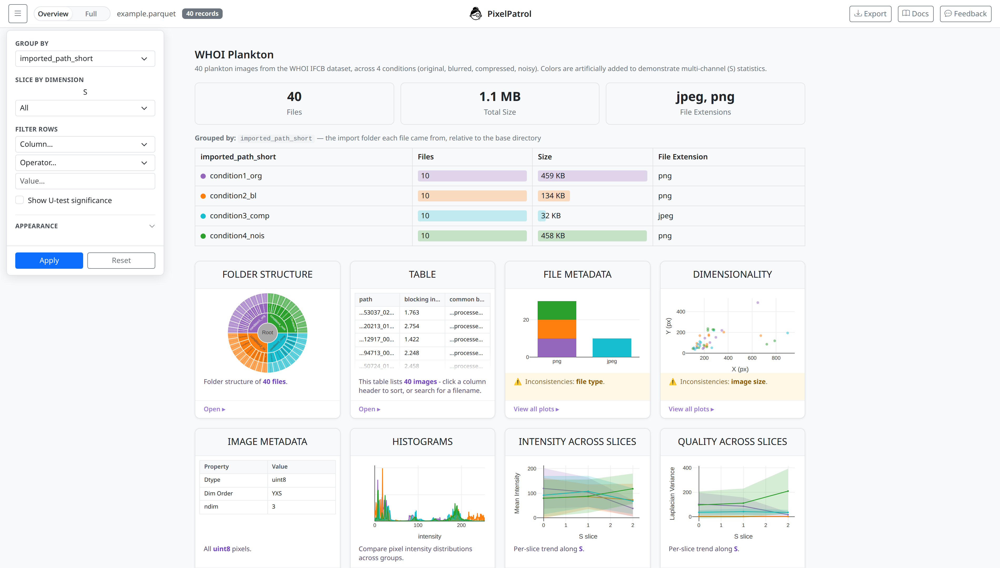
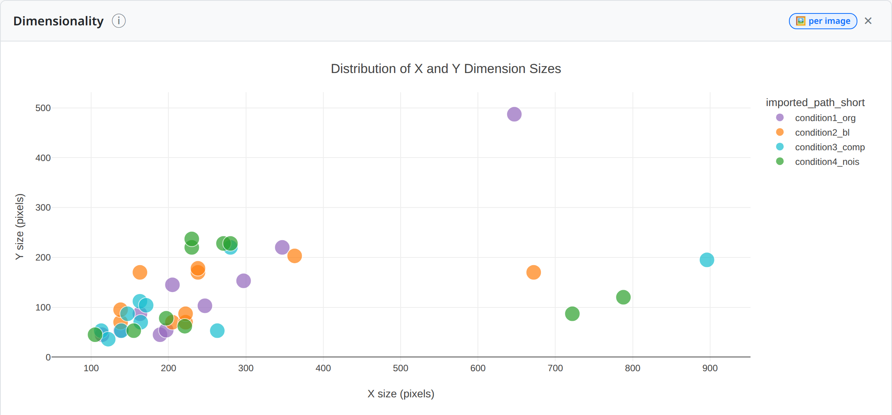
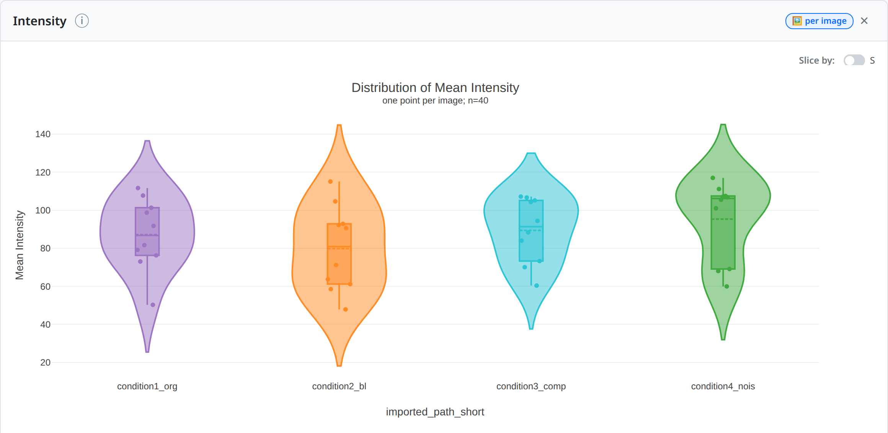
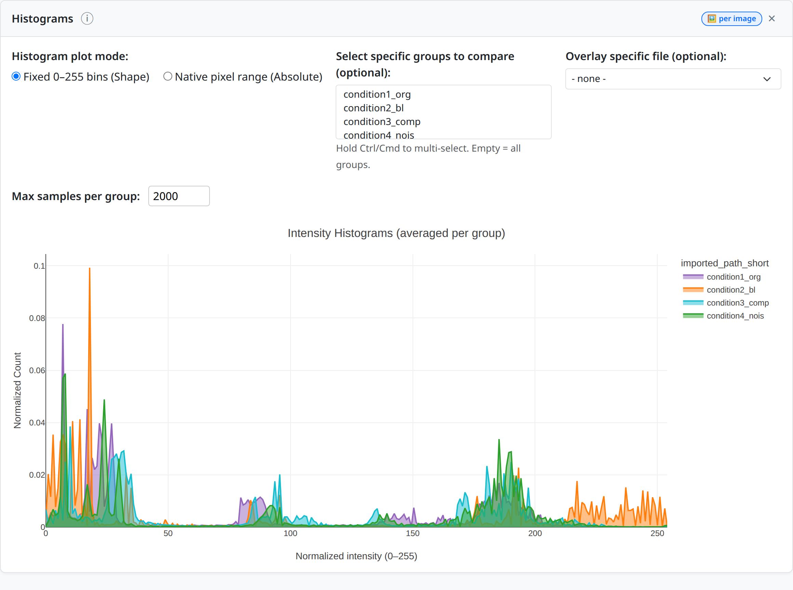

#   PixelPatrol

### Image Dataset Quality Control and Exploration

[](https://doi.org/10.5281/zenodo.23479548)


**[Example Report](https://pixelpatrol.app/viewer/?data=../example.parquet) | [Tutorials](https://pixelpatrol.app/docs/latest/tutorials/) | [Documentation](https://pixelpatrol.app/docs/latest/) | [Viewer](https://pixelpatrol.app/viewer/) | [PyPI](https://pypi.org/project/pixel-patrol/)**

Image datasets are rarely as clean or consistent as they appear. PixelPatrol scans your images and builds a shareable, browser-based interactive report - file and image metadata, pixel statistics, quality metrics, and per-dimension slice statistics - so you can compare conditions, catch outliers, and verify batch consistency before you use the data.



*Overview mode - every widget as a tile; click one to expand it in place.*

---

## Installation

**No terminal?** Use the one-click app instead: [install guide](https://pixelpatrol.app/docs/latest/tutorials/installation/). It runs PixelPatrol in your browser, with no terminal commands or Python API.

**Terminal:** requires Python 3.12+. We recommend [uv](https://docs.astral.sh/uv/):

```bash
uv venv --python 3.12 .venv
source .venv/bin/activate   # Windows: .venv\Scripts\Activate.ps1
uv pip install pixel-patrol
```

For a modular install (core only + selected add-ons):

```bash
uv pip install pixel-patrol-base           # includes image quality metrics
uv pip install pixel-patrol-loader-bio     # BioIO, Zarr, Tifffile, H5 loaders
uv pip install pixel-patrol-loader-medical # NIfTI, DICOM loaders
uv pip install pixel-patrol-geospatial     # GeoTIFF, NetCDF loader
```

---

## Quickstart

**1. Process your dataset:**

```bash
pixel-patrol process path/to/images/ -o results.parquet --loader bioio
```

For datasets with experimental conditions:

```bash
pixel-patrol process path/to/images/ -o results.parquet --loader bioio \
  -p condition_a -p condition_b
```

**2. Explore in the viewer:**

```bash
pixel-patrol view results.parquet
```

Or combine both steps with `--view`:

```bash
pixel-patrol process path/to/images/ -o results.parquet --loader bioio --view
```

To use viewer parameters, run the two commands sequentially:

```bash
pixel-patrol process path/to/images/ -o results.parquet --loader bioio && pixel-patrol view results.parquet
```

**Or use the report manager** for a visual interface - list, add, import, and open reports:

```bash
pixel-patrol launch
```

---

## Python API

```python
from pixel_patrol_base import api

if __name__ == "__main__":
    project = api.create_project("my-project", base_dir="path/to/images/", loader="bioio", output_path="results.parquet")
    api.add_paths(project, ["condition_a", "condition_b"])  # optional
    api.process_files(project)
    api.view(project)
```

---

## Example visualizations



*Spot inconsistent crops or resolutions.*



*See per-image spread and outliers, e.g. mean intensity, across groups.*



*Compare brightness and contrast across conditions.*

---

## Sharing PixelPatrol results

Send the `.parquet` file and open it in the [hosted viewer](https://pixelpatrol.app/viewer/) - no installation needed. Or build a self-contained static viewer:

```bash
pixel-patrol build-viewer-html -o viewer.html             # light (~7 MB), loads DuckDB WASM from a CDN
pixel-patrol build-viewer-html -o viewer.html --offline   # fully self-contained, works with no network
```

> **Note:** The static viewer may not load parquet files larger than a few GB. Use `pixel-patrol view` for large reports.

---

## Extending PixelPatrol

PixelPatrol is designed to be extended with custom loaders, processors, and viewer widgets as standalone Python packages. See [pixel-patrol-example-extension](https://github.com/ida-mdc/pixel-patrol-example-extension) for a working template, and the [Extensions](https://pixelpatrol.app/docs/latest/extensions/) documentation.

---

## Citation

If you use PixelPatrol, please cite it:

```bibtex
@software{pixelpatrol,
  author = {Bahry, Ella and Rossberg, Thomas and Otto, Maximilian and Schmidt, Deborah},
  title  = {PixelPatrol},
  year   = {2026},
  doi    = {10.5281/zenodo.23479548},
  url    = {https://github.com/ida-mdc/pixel-patrol}
}
```
